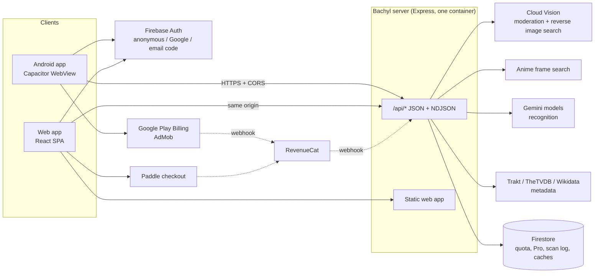

# Product overview

**Bachyl** identifies a movie, series or anime from a single frame: a screenshot, a photo of a TV, or the live camera. It answers with the title, year, director or studio, the scene, and how sure it is, then adds verified metadata from film databases.

- Android app on [Google Play](https://play.google.com/store/apps/details?id=com.bachyl.app) (Capacitor WebView + a few native plugins)
- Web app (the same React code, served by the same server)
- Languages: English, Russian, Belarusian
- Free tier with a daily limit, ads on Android, a Pro subscription (Google Play, Paddle on the web)

The application code is in a private repository. This repository holds its test documentation and automated tests, which run against a build of the server.

## Architecture

## What happens in one scan

1. The client sends the frame (base64), the UI language and an optional hint to `POST /api/identify-frame`, with a Firebase ID token.
2. The server checks the caller and reserves one search from the daily quota. The quota lives on the server only; the client just shows it.
3. A moderation check rejects clearly adult images before any paid AI call.
4. Reverse image search and, for anime, a frame search collect evidence.
5. A **standard** search asks one model once. A **deep** search (Pro, or after a rewarded ad) escalates through stronger models and a web search while the answer is unsure.
6. Metadata databases confirm the title and year. A wrong film is worse than none, so matching is strict.
7. The answer goes back with a confidence score and up to five alternates. With `progress: true` the client gets live NDJSON stages first.
8. Any failure on the server's side refunds the reserved search.

## Properties that matter for testing

| Property                                                                       | Why it matters                                                                                                  |
| ------------------------------------------------------------------------------ | --------------------------------------------------------------------------------------------------------------- |
| The AI answer is not deterministic                                             | UI tests mock the scan; accuracy is measured separately on a fixed dataset (see [ai-quality.md](ai-quality.md)) |
| Without an AI key the server runs in **demo mode** and returns a fixed answer  | API and UI tests run for free and offline from paid services                                                    |
| Every external integration fails open (missing key = feature off, not a crash) | Tests can run with no secrets at all                                                                            |
| Quota, Pro and rewards are decided by the server only                          | Security tests attack the API directly, not the UI                                                              |
| One codebase serves Android and web                                            | Most checks run once in a browser; only native parts need a device                                              |
| Each scan costs real money (2–5 cents)                                         | No test may call the paid pipeline except the budgeted nightly evaluation                                       |
