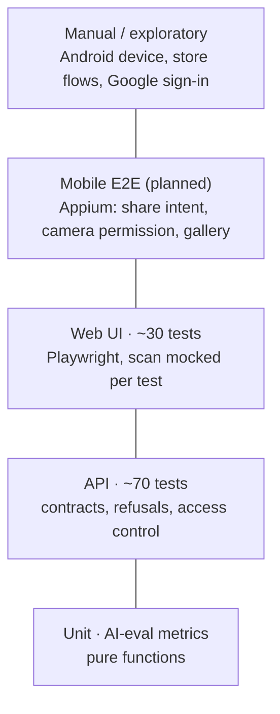

# Test strategy

Owner: Mikhail · Applies to: Bachyl server, web app, Android app · Last review: November 2026

## 1. Quality goals

In order of importance:

1. **The answer is honest.** A confident wrong answer hurts more than "not sure". We track how often the app is wrong at 75%+ confidence, not only overall accuracy.
2. **Money can't leak.** Nobody gets free searches, Pro or rewards by calling the API directly. A bug here costs real money on every request.
3. **A scan never leaves the user stuck.** Every failure (AI overloaded, unsafe image, limit, no network) ends with a readable message and a way to retry.
4. **It works on a cheap phone in all three languages.** 320 px wide, Russian and Belarusian labels that run long, slow WebView.
5. **No personal data leaks.** The scan log is anonymous; images are never stored.

## 2. What we test, and how

| Layer         | Tool                                    | Runs against                                                  | Covers                                                                                                                                        | Doesn't cover           |
| ------------- | --------------------------------------- | ------------------------------------------------------------- | --------------------------------------------------------------------------------------------------------------------------------------------- | ----------------------- |
| Unit          | Playwright test runner                  | nothing                                                       | The accuracy metrics used by the nightly evaluation                                                                                           | App code (it's private) |
| API           | Playwright `request` + Zod schemas      | Server in demo mode                                           | Response contracts, status codes, negative input, CORS, access control on quota/Pro/rewards, streaming format                                 | Recognition quality     |
| Web UI        | Playwright + Page Objects               | Same server; `/api/identify-frame` and `/api/feedback` mocked | Every result state (confident, unsure, unknown, anime), error messages, limit dialog, feedback, language switch, 320 px layout, accessibility | Native Android features |
| AI evaluation | Scripted run + metrics                  | Real backend with a separate, capped key                      | Top-1/top-3, confident errors, calibration, latency, by type and difficulty                                                                   | UI                      |
| Mobile        | Appium + WebdriverIO (planned)          | Android emulator                                              | Share-to-app intent, camera and gallery, back button, rotation, no network                                                                    | Google sign-in (manual) |
| Manual        | Checklists in [test-cases](test-cases/) | Real phone, production                                        | Purchases, ads, store listing, Google sign-in, first-run experience                                                                           | —                       |

**Why mocks in UI tests.** The AI answer changes from run to run, and every real scan costs money. A UI test asks "does the app show a 55% answer as 'Not sure' with candidates?", which needs a 55% answer on demand. The mock gives exactly that, so the test fails only when the UI is wrong. Mocks are built from the same Zod schemas as the API contract tests, so a mock can't drift from the real response shape without a contract test failing first.

**Why demo mode for API tests.** The server answers a fixed result when it has no AI key, and every other integration (metadata, email, Firestore) switches itself off. That is the product's own design, so tests use it instead of a second test-only code path.

**What we deliberately don't automate:**

- **Google sign-in.** Google blocks automated browsers on its consent screen, and faking it would test the fake. Covered by a manual checklist and by the email-code path, which reaches the same account logic.
- **Real purchases and real ads.** Store sandboxes need real accounts and devices; automating them is slow and brittle. Covered manually before each release; the server side (webhook auth, entitlement checks) is covered by API tests.
- **Recognition accuracy in the PR pipeline.** It costs money and isn't deterministic. It runs nightly with a budget and a regression threshold.
- **Visual pixel comparison.** The screens animate and use live trending data; layout rules (no overflow at 320 px) catch the bugs that actually happened, with no screenshot churn.

## 3. Test data

- **Frames are generated in code** (a gradient PNG). The public repository never holds frames from real films.
- **Results are factories** (`src/data/results.ts`) with made-up titles, so a UI test never looks like a claim about a real film.
- **Emails** use the reserved `example.test` domain.
- The evaluation dataset is a manifest of expected answers; the images stay in private storage.

## 4. Environments

| Environment        | Purpose                          | AI                        | Database                    |
| ------------------ | -------------------------------- | ------------------------- | --------------------------- |
| Local              | Writing tests                    | Demo mode                 | None (features fail open)   |
| CI                 | Every PR and every new app build | Demo mode                 | Firebase Emulator (planned) |
| Nightly evaluation | Accuracy trend                   | Real, separate capped key | Production read-only        |
| Production         | Manual release checks            | Real                      | Real                        |

Tests never run against production automatically: a scan there is billed.

## 5. Entry and exit criteria

**A build enters testing when** the server image builds and `/api/health` answers.

**A release is ready when:**

- all `@smoke` tests pass on Chromium and the mobile viewport;
- the full regression passes on Chromium, Firefox, WebKit and the mobile viewport;
- no open bug of severity `critical` or `major` in the release scope;
- accuracy hasn't dropped more than 5 points from the baseline, and the confident-error rate hasn't grown;
- the Android manual checklist passes on one real device.

## 6. Defects

Bugs are GitHub issues from the Bug report form, with a severity and a priority:

| Severity | Meaning                                                        | Example                                              |
| -------- | -------------------------------------------------------------- | ---------------------------------------------------- |
| critical | Money or data at risk, or the main flow is broken for everyone | Quota bypass, scans fail for all users               |
| major    | A main flow is broken for some users, no workaround            | Android shows a white flash and freezes after upload |
| minor    | Works, but wrong or confusing                                  | Belarusian dates printed in Russian                  |
| trivial  | Cosmetic                                                       | Low contrast on footer text                          |

A known bug that an automated test reproduces is marked with `test.fail()` and the `@known-bug` tag. The test turns red when the bug is fixed, which is the reminder to remove the mark.

## 7. Reporting

- Playwright HTML report and traces for every CI run (artifacts).
- JUnit XML for the CI summary.
- Nightly evaluation: metrics JSON committed to the repository, trend in the report.
